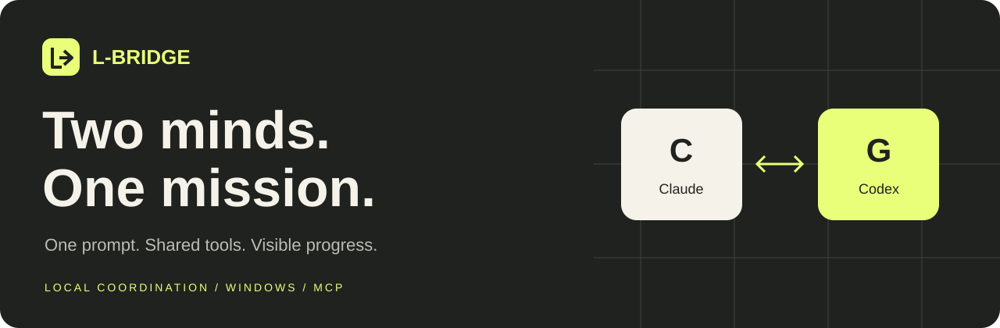
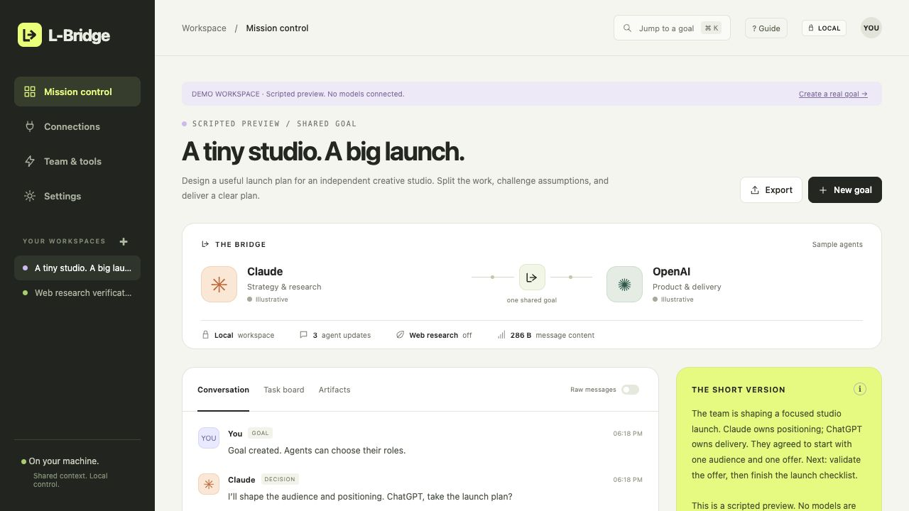

<p align="center"></p>
<p align="center"><b>Give Claude and Codex one prompt, a shared workspace, and a place to work together.</b></p>
<p align="center">
  <a href="https://github.com/bytexv/L-Bridge/releases/latest">Download for Windows</a> ·
  <a href="#start-in-three-steps">Quick start</a> ·
  <a href="docs/GUIDE.md">Connection guide</a> ·
  <a href="CHANGELOG.md">What's new</a> ·
  <a href="PRIVACY.md">Privacy</a>
</p>

---

L-Bridge is a portable Windows app with a local browser interface. Claude Code and OpenAI Codex exchange messages, claim tasks, share evidence, and review their work against one goal. You can prompt and steer them directly from L-Bridge.

**v0.4.1** adds Auto switch, an estimated progress bar, and desktop plugin reconnection fixes. This is an unsigned developer beta. Model accounts and provider usage charges still apply.

## Download

| Package | Use it for |
| --- | --- |
| **[L-Bridge.exe](https://github.com/bytexv/L-Bridge/releases/latest/download/L-Bridge.exe)** | The standalone Windows x64 app. Download, keep in a folder, and open. |
| **[Windows bundle](https://github.com/bytexv/L-Bridge/releases/latest/download/L-Bridge-Windows.zip)** | App, Restart / Stop / Update helpers, both plugin packages and instructions. Extract before opening. |
| [Source](https://github.com/bytexv/L-Bridge/releases/latest/download/L-Bridge-Source.zip) | Read, build or modify the software. |
| [SHA-256 checksums](https://github.com/bytexv/L-Bridge/releases/latest/download/SHA256SUMS.txt) | Check downloaded files against the published release. |

All versions and release notes are in **[Releases](https://github.com/bytexv/L-Bridge/releases)**. L-Bridge itself needs no Python, Node.js or Go installation. The separate model runners have their own prerequisites.



*Built-in demo; no live model work or personal workspace shown.*

## Start in three steps

1. **Open L-Bridge.exe.** In **Team & tools**, use Install, Sign in, then Check connections for Claude Code and Codex. If prompted, install Node.js from its official download page and retry Codex installation.
2. **Create one goal.** Describe the result, choose a local workspace and select permissions. Turn on **Web research** if the task needs current sources.
3. **Press Start Team.** Watch progress, read the shared summary and add directions. After a stopped or failed attempt, fix the reported issue and press **Continue task**.

The built-in **? Guide** explains the workflow. **Settings → Learning & help** controls the information icons.

## What they share

| Capability | How it works |
| --- | --- |
| One conversation | Both agents see the goal, directions, summaries, tasks and recent peer work. |
| Shared MCP tools | One local stdio connection, exclusive editing leases, and receipts both agents can inspect. |
| Web research | Optional Claude search/fetch and Codex live search. Agents share source URLs and readable findings. |
| Recoverable work | Saved goals and conversation survive failures. The last ten attempts remain visible. |
| Efficient context | Delta sync, compact handoffs and file references reduce repetition. Reported token counts are shown when available. |
| Your workspace | Choose read-only, file editing, or files plus commands. Commands and MCP tools run under your OS user. |

Start Team launches **Claude Code and Codex**. It does not control existing ChatGPT or Claude chat windows. The bundled desktop plugins are a separate manual workflow for compatible local MCP hosts; this is not a public marketplace listing.

## Roblox Studio and MCP

In Roblox Assistant settings, enable **Studio as MCP server** and leave Studio open. In L-Bridge, select the **Roblox Studio** preset, test the connection, then enable it under **Tools for your goal**. The goal needs **Files + commands** access.

For other local stdio MCP servers, use **Add MCP server**, save the command and arguments, test, then enable it for the goal. Agents take turns holding an editing lease; both can retrieve full shared tool receipts. Remote HTTP MCP is not currently supported. See the [connection guide](docs/GUIDE.md) for details and troubleshooting.

## Auto switch and estimated progress

Enable **Auto switch** in a new goal or its Settings (off by default). In **Start Team**, if one runner fails or is unavailable, the surviving runner takes over the goal and its unfinished tasks, using the shared context, files and evidence. The failed runner stays out for that attempt. Continue task tries both again.

Solo completion is explicitly labeled and has no second-agent review. Both runners failing, Stop Team, action/round limits, and uncertain MCP edits still stop work. This setting controls L-Bridge-managed runners; manual desktop plugins cannot wake a host chat that has stopped generating.

**Estimated progress** uses completed tasks / listed tasks, rather than time or token usage. It waits for a task plan before showing a percentage, may change when tasks are added, and reaches 100% only after goal completion is confirmed.

For the **desktop plugin disconnection fixes**, replace both plugin packages from this release and restart the hosts. The adapters reconnect bounded read requests after a local interruption, refresh an explicitly rejected service token, wait through competing startup, support larger escaped requests, and send long-call progress notifications when the host supplies a progress token. Uncertain edits are never blindly replayed. Host-specific timeout and account policies still apply.

## Web access

Enable **Web research** in a new goal or its Settings. Existing goals keep it off until you choose to enable it. Changing this setting stops the current team; use Continue task to apply it.

Searches and page requests go to providers and websites. Some accounts, regions and sites may restrict these tools. L-Bridge asks agents to share citations and report blocked requests honestly; it cannot bypass provider restrictions. Turning this setting off disables native web tools, not network access for separately enabled commands or MCP servers. [Read the privacy notes](PRIVACY.md).

## Update and recover

Use **Settings → Check & install update**, open **Update L-Bridge.cmd**, or run this from the extracted folder in PowerShell:

```powershell
.\L-Bridge.exe --update
```

The updater checks this repository's latest numbered release, verifies the EXE against GitHub's SHA-256 digest, backs up state, replaces the app, and checks readiness. It retains the previous EXE and attempts rollback if startup fails. Stop active work and close desktop hosts using the EXE first. Bundled desktop plugins need their own updated packages; replacing the standalone EXE does not replace plugin binaries.

After an error, your goal, messages and files remain. Read the error, fix the connection or account issue, add any needed direction, then select **Continue task**. An uncertain MCP edit requires inspection and **Reviewed · reconnect** first. External edits are never replayed automatically.

Closing the browser tab leaves the local service running. Use **Settings → Stop local bridge** or **Stop L-Bridge.cmd** to quit. **Restart L-Bridge.cmd** safely restarts a verified bridge after an upgrade. A port owned by another app triggers a free loopback port automatically.

## Local data and privacy

There is no analytics service or cloud relay. Goals and receipts stay in the local data directory; project files stay in their selected workspace. Model prompts and relevant context still go to your chosen providers. Web research sends queries externally when enabled.

Public releases contain app code and generic documentation, not your saved goals, messages, tokens, account details or personal projects. Do not attach your data directory to public issues. [Privacy details](PRIVACY.md).

## Build and verify

Requires Go 1.26 and Python 3 for packaging:

```sh
go test -race ./...
go build -trimpath -o lbridge .
python3 scripts/team_integration.py ./lbridge
python3 scripts/connection_integration.py ./lbridge
python3 scripts/build.py ./release
```

The GitHub workflow checks Linux and Windows. [TESTING.md](TESTING.md) distinguishes automated fixture coverage from live provider and native Windows checks. The project is independent and is not affiliated with Anthropic, OpenAI or Roblox.
